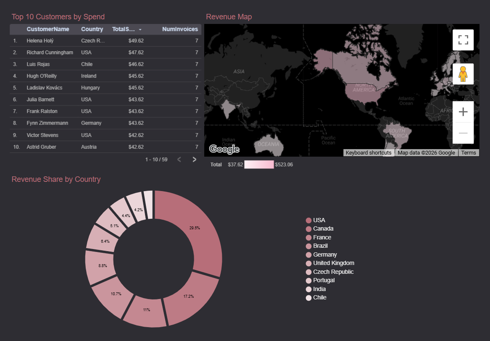
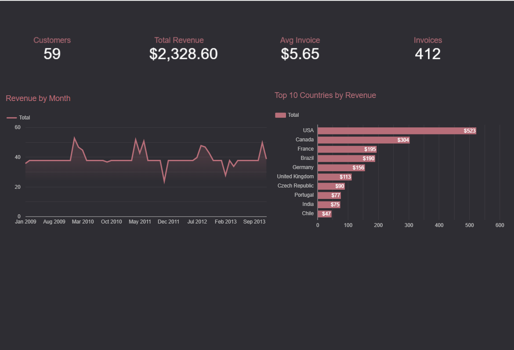
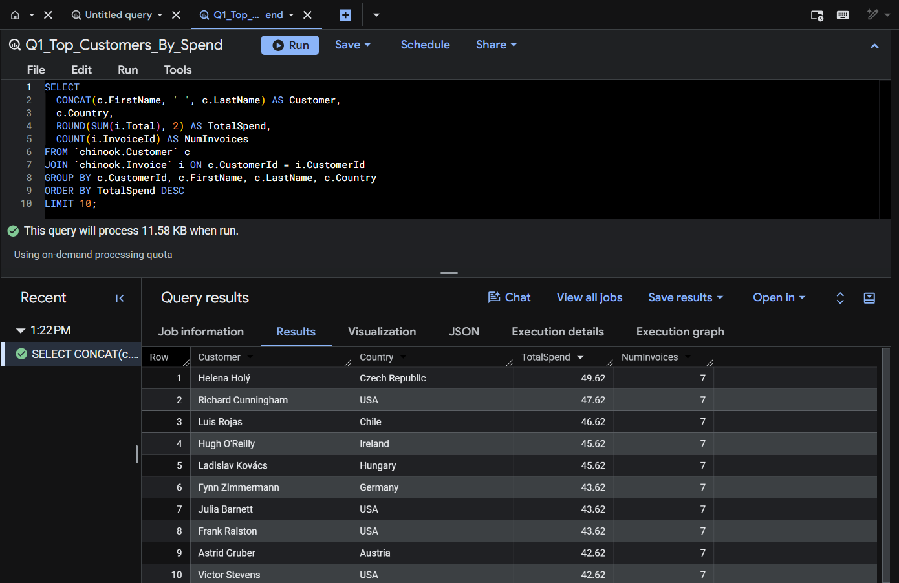
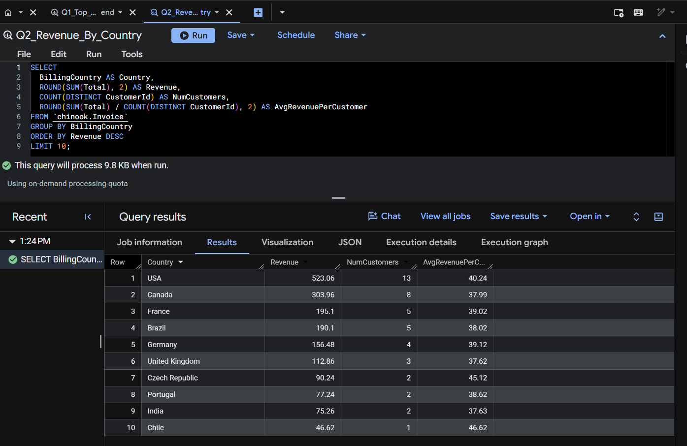
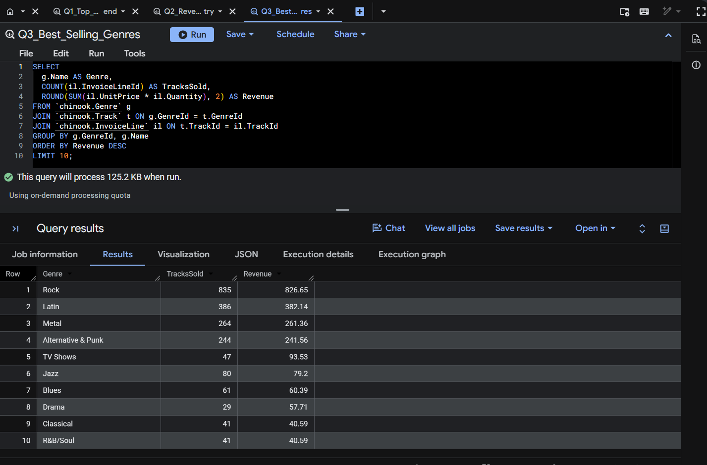
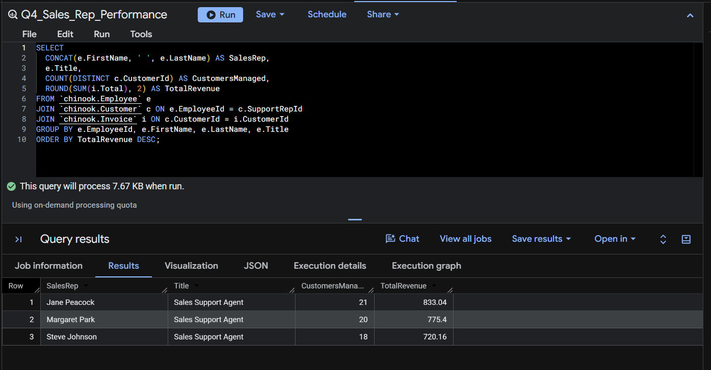
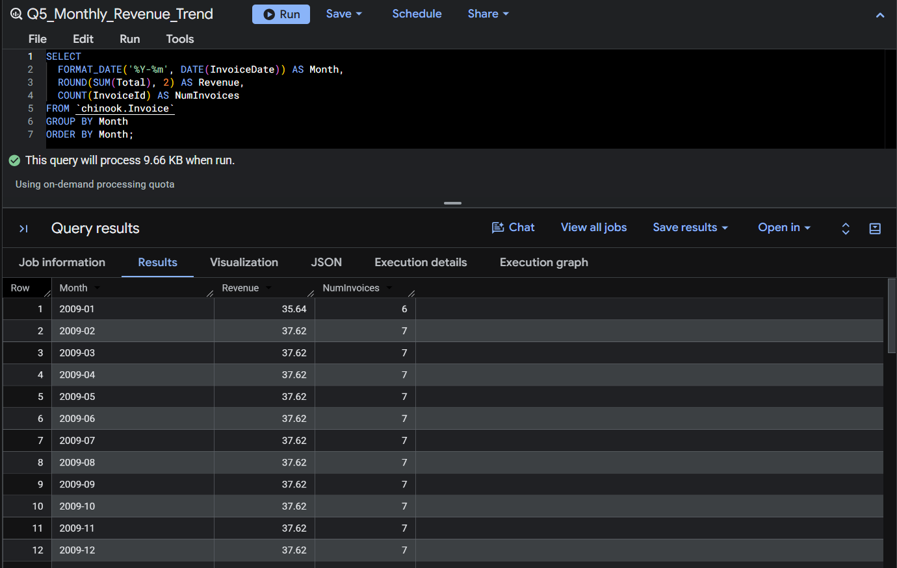
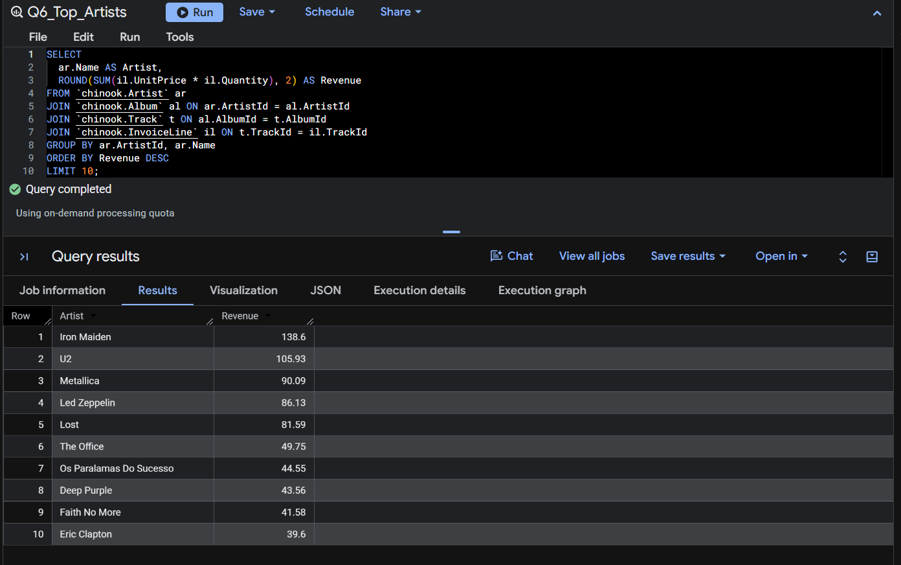
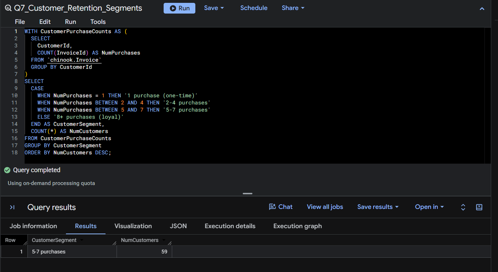

# Chinook Music Store Analytics

Cloud data warehouse case study on the Chinook music store dataset. Loaded a full relational schema into Google BigQuery, wrote analytical SQL to answer 7 commercial questions, and published a 2-page executive dashboard in Looker Studio.

## Dashboard

Live Looker Studio dashboard: [Chinook Music Store Sales Analytics](https://datastudio.google.com/reporting/acecfebf-1218-474a-acd6-060d562effde)

## Problem

Chinook is a sample relational database representing a digital music store. 11 tables, 59 customers, 275 artists, 3,503 tracks, 412 invoices across 5 years. Classic business questions apply: who are the best customers, where is the revenue coming from, which products drive it, how is retention trending.

The project: build a modern cloud analytics stack on top of it (data warehouse + semantic views + BI dashboard) that mirrors how a real analytics team would deliver insights to executives.

## Approach

1. **Ingestion:** Exported Chinook SQLite to 11 CSVs, loaded each as a BigQuery table in a `chinook` dataset (EU region)
2. **SQL analytics:** Wrote 7 analytical queries using joins, CTEs, window functions, and case-based segmentation (see `sql/` folder)
3. **Semantic layer:** Created a reusable SQL view (`v_top_customers`) to expose clean, pre-joined data for downstream BI
4. **BI dashboard:** Published a 2-page Looker Studio report connected directly to BigQuery

## The 7 business questions

Each query lives in `sql/` as a standalone file. Click the query name to view the SQL. Result screenshots show the BigQuery output.

### 1. Top customers by total spend
[Query](sql/Q1_top_customers.sql) · Helena Holý (Czech Republic) leads at $49.62, with the top 10 spread tightly between $42 and $49

### 2. Revenue by country
[Query](sql/Q2_revenue_by_country.sql) · USA leads with $523, Canada second at $304. Czech Republic punches above its weight on AOV

### 3. Best-selling genres
[Query](sql/Q3_best_selling_genres.sql) · Rock dominates volume. TV Shows show high revenue per unit (premium pricing)

### 4. Sales rep performance
[Query](sql/Q4_sales_rep_performance.sql) · Jane Peacock leads at $833. All reps are Sales Support Agents with similar customer loads

### 5. Monthly revenue trend
[Query](sql/Q5_monthly_revenue_trend.sql) · Revenue averages ~$37/month across 60 months with occasional spikes

### 6. Top artists by revenue
[Query](sql/Q6_top_artists.sql) · Iron Maiden tops at $139, followed by U2 and Metallica. Rock bands dominate

### 7. Customer retention segmentation
[Query](sql/Q7_customer_retention_segments.sql) · Customer base is remarkably loyal: nearly every customer sits in the 5-7 purchases segment

## Key findings

- USA leads revenue (29.5% share), Canada second (17.2%), long tail across Europe and Latin America
- Czech Republic punches above its weight on average revenue per customer
- Rock dominates genre revenue, but TV Shows generate high revenue per unit sold (premium pricing)
- Sales reps are evenly loaded but revenue per rep varies by 15%, room for best-practice sharing
- Customer base is heavily loyal: nearly every customer falls into the 5-7 purchases segment

## Stack

- **Warehouse:** Google BigQuery (EU region, sandbox mode)
- **Query language:** Standard SQL (joins, CTEs, window functions, aggregations)
- **BI:** Looker Studio connected directly to BigQuery
- **Source dataset:** [Chinook sample database](https://github.com/lerocha/chinook-database)

## What this project demonstrates

- End-to-end cloud analytics workflow: raw source to warehouse to semantic layer to dashboard
- SQL fluency on realistic relational schemas with 11 joined tables
- Business framing: each query maps to a decision a manager would actually make
- BI storytelling: 2-page dashboard structured as executive overview plus customer deep-dive

---

**Author:** Mariem Gadri — [LinkedIn](https://linkedin.com/in/mariemgadri)